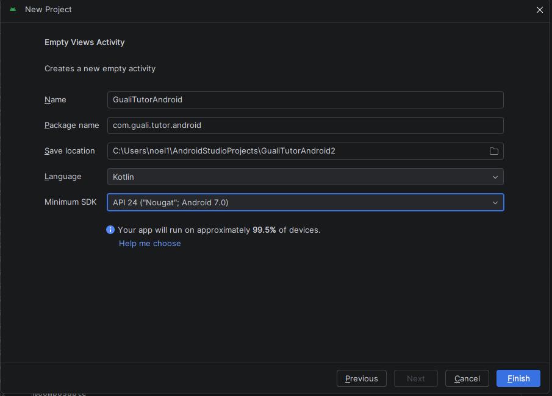
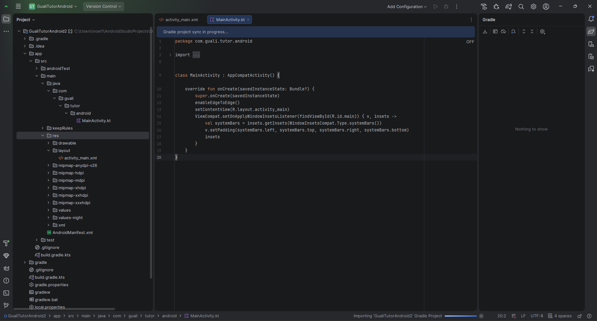
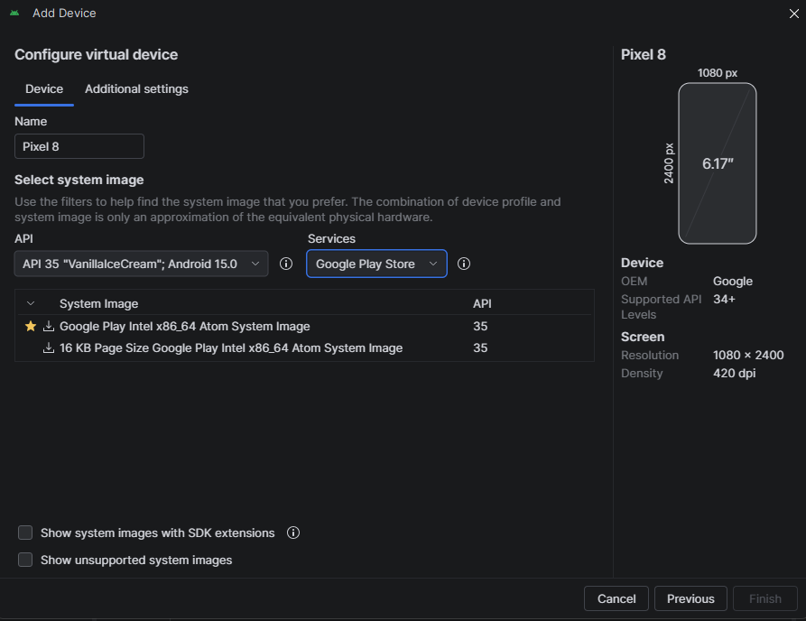
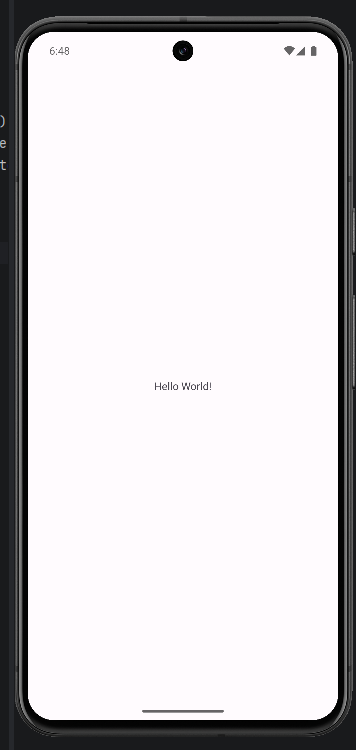
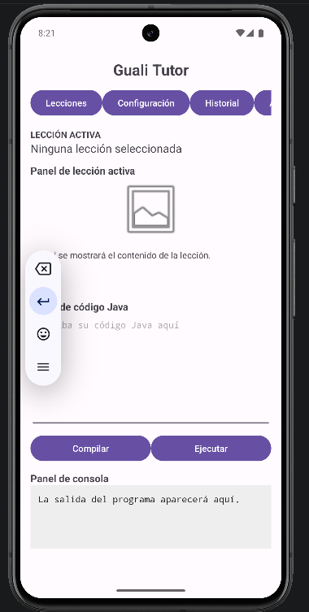

# Tutorial: Desarrollo del Frontend Guali Tutor en Android

## 1. Introducción

Este tutorial explica paso a paso cómo crear la interfaz móvil de Guali Tutor mediante Android Studio, utilizando Kotlin y XML.

El proyecto corresponde a la Fase 3 del curso Programación II de la Universidad Mariano Gálvez de Guatemala.

El objetivo es desarrollar el frontend Android tomando como referencia la interfaz principal de Guali Tutor.

## 2. Prerrequisitos

Para desarrollar el proyecto se necesita:

- Una computadora con Windows de 64 bits.
- Android Studio instalado.
- Android SDK y Android Emulator.
- Conexión a Internet para descargar las herramientas.
- Conocimientos básicos de programación.

### Tecnologías utilizadas

| Tecnología | Uso |
|---|---|
| Android Studio | Entorno de desarrollo |
| Kotlin | Lenguaje de programación |
| XML | Diseño de la interfaz |
| Gradle | Compilación del proyecto |
| Android Emulator | Ejecución de la aplicación |

## 3. Instalación de Android Studio

1. Ingresar a https://developer.android.com/studio
2. Descargar el instalador de Android Studio para Windows.
3. Ejecutar el instalador.
4. Seguir el asistente de instalación.
5. Instalar los componentes del Android SDK recomendados.
6. Iniciar Android Studio.

## 4. Creación del proyecto

1. Seleccionar New Project.
2. Elegir Phone and Tablet.
3. Seleccionar Empty Views Activity.
4. Configurar los siguientes datos:

- Name: GualiTutorAndroid
- Package name: com.guali.tutor.android
- Language: Kotlin
- Minimum SDK: API 24 (Android 7.0)

5. Presionar Finish.
6. Completar la sincronización de Gradle.

## 5. Estructura del proyecto

Los archivos principales son:

- MainActivity.kt: contiene la actividad principal desarrollada en Kotlin.
- activity_main.xml: define los componentes gráficos.
- AndroidManifest.xml: contiene la configuración de la aplicación.
- build.gradle.kts: administra la configuración de compilación.

El archivo activity_main.xml se encuentra en:

app/src/main/res/layout/activity_main.xml

La actividad principal se encuentra en:

app/src/main/java/com/guali/tutor/android/MainActivity.kt

## 6. Configuración del emulador

1. Abrir View > Tool Windows > Device Manager.
2. Seleccionar Create Virtual Device.
3. Elegir el teléfono Pixel 8.
4. Seleccionar Android 15, API 35.
5. Descargar la imagen Google Play Intel x86_64.
6. Finalizar la configuración.
7. Iniciar el dispositivo virtual.

## 7. Primera ejecución

1. Abrir el proyecto en Android Studio.
2. Seleccionar el emulador Pixel 8.
3. Seleccionar la configuración app.
4. Presionar Run.
5. Comprobar que la pantalla inicial muestre Hello World!

Esta prueba permite confirmar que el entorno está preparado correctamente.

## 8. Desarrollo de la interfaz principal

Abrir el archivo activity_main.xml y seleccionar la vista Code.

Reemplazar su contenido con el diseño de la interfaz Guali Tutor, disponible en el siguiente archivo del proyecto:

[Consultar activity_main.xml](app/src/main/res/layout/activity_main.xml)

La estructura utiliza un ScrollView principal y un LinearLayout con orientación vertical.

### Componentes implementados

**Título principal**

Se utiliza un TextView para mostrar el nombre Guali Tutor.

**Barra de menú**

Se implementa utilizando HorizontalScrollView y botones para representar:

- Lecciones
- Configuración
- Historial
- Ayuda

**Lección activa**

Se utiliza un TextView para indicar el nombre de la lección seleccionada.

**Panel de lección**

Está formado por un ImageView para representar las imágenes y un TextView para el contenido explicativo.

**Editor de código**

Se implementa mediante EditText, configurado para permitir varias líneas y utilizar una fuente monoespaciada.

**Botones de acción**

Se agregan los botones Compilar y Ejecutar dentro de un LinearLayout horizontal.

**Panel de consola**

Se utiliza un TextView para representar el área de salida del programa.

### Archivo Kotlin

MainActivity.kt utiliza setContentView(R.layout.activity_main) para cargar el diseño XML.

No fue necesario modificar la actividad principal generada por Android Studio.

## 9. Ejecutar la interfaz de Guali Tutor

1. Guardar los cambios realizados en activity_main.xml.
2. Seleccionar el emulador Pixel 8.
3. Presionar Run.
4. Comprobar que aparezca la interfaz Guali Tutor.
5. Verificar el desplazamiento vertical.
6. Verificar el desplazamiento horizontal de la barra de menú.
7. Escribir texto en el editor de código.

## 10. Resultado

Se desarrolló y ejecutó la interfaz principal de Guali Tutor en Android utilizando Kotlin y XML.

La interfaz contiene los elementos visuales especificados para la aplicación: menú, lección activa, panel de contenido, editor de código, botones de acción y consola.

El alcance implementado corresponde al frontend visual. No incluye integración con la API REST ni ejecución de código Java desde Android.
